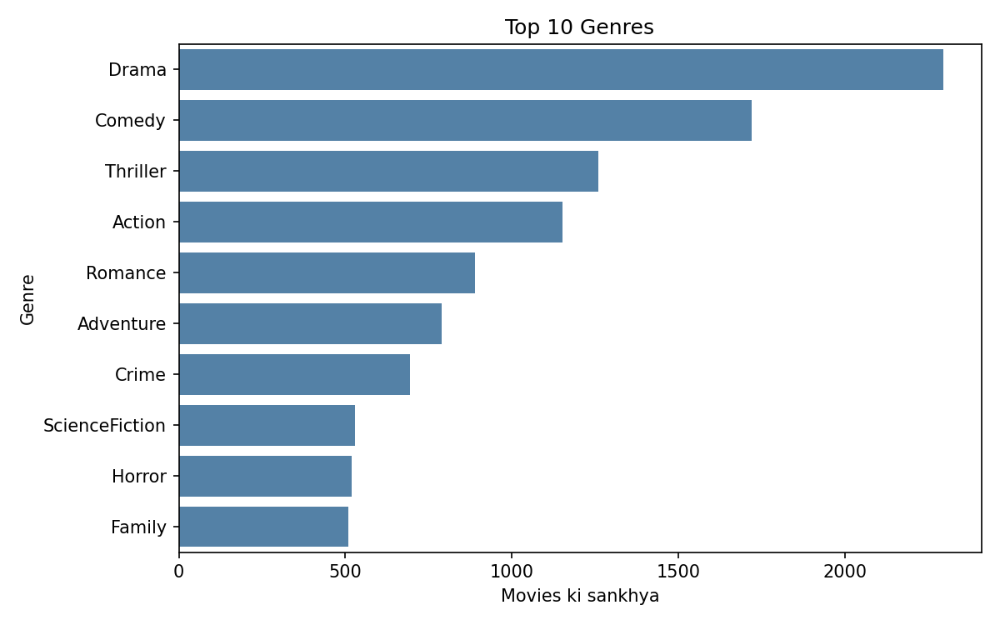
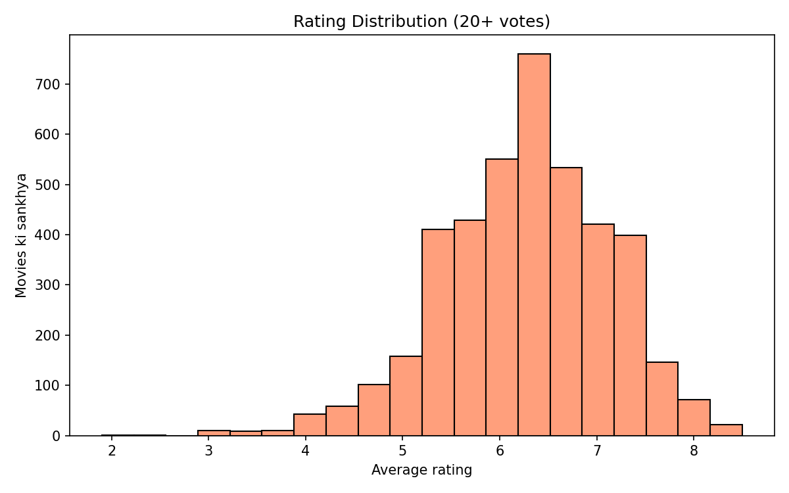
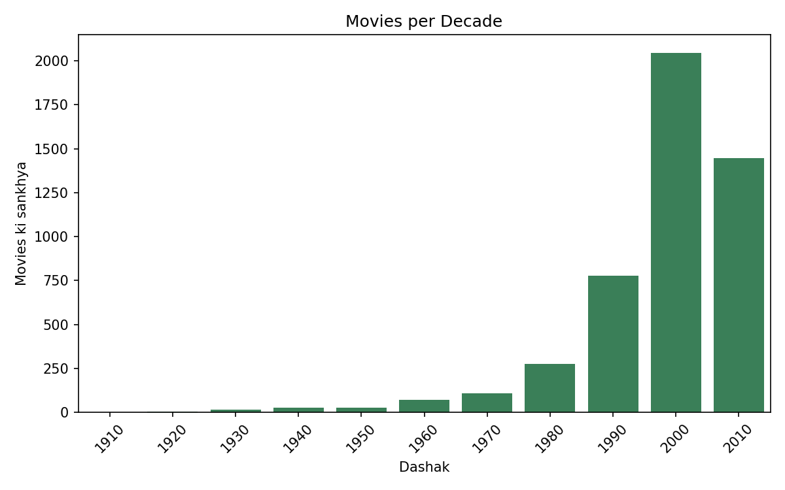

# 🎬 Movie Recommendation Engine

A content-based movie recommender built on the **TMDB 5000 Movies** dataset. Pick a movie and get a ranked list of similar movies, based on genres, keywords, plot overview, cast and director.

**Live demo:** _add your Streamlit link here after deploying_


## How it works

1. **Clean the data.** Fill missing text with empty strings, drop rows with no release date, and keep the most-voted entry for duplicate titles.
2. **Build a `tags` column.** Genres, keywords, overview, cast and director are combined into one text field per movie.
3. **Vectorize with TF-IDF.** Each movie becomes a vector, using unigrams and bigrams, with common English words removed.
4. **Rank by cosine similarity.** The movies closest to the selected movie are returned, excluding the movie itself and movies with very few votes.

### Feature engineering details

| Step | Why |
|---|---|
| Convert `Science Fiction` to `ScienceFiction` | A genre should be one token, not two unrelated words |
| Convert `James Cameron` to `JamesCameron` | Stops different directors who share a first name from looking similar |
| Fix unicode escapes (`Cuar\u00f3n` to `Cuarón`) | The raw data stores some characters as literal text, which creates wrong tokens |
| Genres weighted 2x, director weighted 3x | Short, high-signal fields should matter more than the long overview text |
| Bigrams (`ngram_range=(1, 2)`) | Lets pairs such as `woody allen` match as a unit |
| Minimum votes filter (default 20) | Removes obscure movies that have very little data |

## Example results

**Avatar**

| # | Movie | Director | Similarity |
|---|---|---|---|
| 1 | Aliens | James Cameron | 0.339 |
| 2 | Terminator 2: Judgment Day | James Cameron | 0.293 |
| 3 | True Lies | James Cameron | 0.281 |
| 4 | The Terminator | James Cameron | 0.271 |
| 5 | The Abyss | James Cameron | 0.264 |

**The Dark Knight**

| # | Movie | Director | Similarity |
|---|---|---|---|
| 1 | Batman Begins | Christopher Nolan | 0.527 |
| 2 | The Dark Knight Rises | Christopher Nolan | 0.517 |
| 3 | The Prestige | Christopher Nolan | 0.316 |
| 4 | Insomnia | Christopher Nolan | 0.255 |
| 5 | Interstellar | Christopher Nolan | 0.250 |

## Exploratory analysis

| Top genres | Rating distribution | Movies per decade |
|---|---|---|
|  |  |  |

## Evaluation

The TMDB dataset has no user ratings, so there is no ground truth to compute a metric such as RMSE or Precision@K against. This model is therefore evaluated **qualitatively**, by inspecting recommendations for well-known movies (Avatar, Toy Story, The Dark Knight).

Quantitative evaluation is planned for the hybrid version, which will use MovieLens user ratings with a train/test split.

## Design trade-offs

- **Director weight.** With the director weighted 3x, movies by the same director rank highest. For example, Avatar recommends several James Cameron films. Lowering the weight gives more genre-based results, but the list then includes lower-rated movies. The weights are easy to change in the notebook.
- **No sense of "feel".** The model matches words, so it can place a dark thriller close to a fantasy adventure if they share a director and some genres.
- **Cold start.** Content-based filtering needs no user history, but it also cannot learn personal taste.

## Project structure

```
├── app.py                # Streamlit app
├── movie.ipynb           # Full pipeline: cleaning, features, model, EDA
├── movies_clean.csv      # Movie table used by the app
├── tfidf_matrix.npz      # Saved TF-IDF matrix used by the app
├── chart_*.png           # EDA charts
├── requirements.txt
└── README.md
```

The full 4799 x 4799 similarity matrix (about 180 MB) is not saved. The app computes similarity for the selected movie on demand from the compact TF-IDF matrix.

## Run locally

```bash
git clone https://github.com/parasgaminga2z-lang/movie-recommendation-engine.git
cd movie-recommendation-engine
pip install -r requirements.txt
streamlit run app.py
```

To rebuild the model, download `movies.csv` (TMDB 5000 Movies, from Kaggle), place it in the project folder, and run all cells in `movie.ipynb`.

## Tech stack

Python, pandas, NumPy, scikit-learn (TF-IDF, cosine similarity), SciPy, Matplotlib, Seaborn, Streamlit

## Next steps

- Add MovieLens ratings and build a collaborative filtering model
- Combine both into a hybrid recommender
- Evaluate with RMSE and Precision@K on a held-out test set

## Author

**Paras Panwar**
GitHub: [@parasgaminga2z-lang](https://github.com/parasgaminga2z-lang)

## Data source

TMDB 5000 Movie Dataset (movie metadata from The Movie Database).